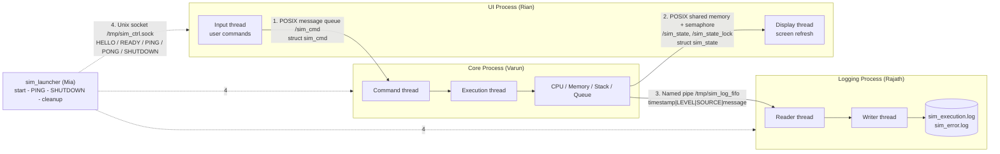

# IPC Architecture Diagram

## How to draw it (boxes and arrows)

Draw **three big boxes side by side**, plus one box on top and the launcher/control line.

| Box | Contents |
|---|---|
| **UI Process** (Rian) | main thread: user input -> commands; display thread: reads state and refreshes screen |
| **Core Process** (Varun) | command thread; execution thread running **CPU / Memory / Stack / Queue** |
| **Logging Process** (Rajath) | reader thread (FIFO -> buffer); writer thread (buffer -> `sim_execution.log`, `sim_error.log`) |
| **sim_launcher** (Vinisha) | starts Logger -> Core -> UI, sends PING, sends SHUTDOWN, final cleanup |

Arrows (always label name + technique + direction + data format):

| # | From -> To | Technique | Name | Data format |
|---|---|---|---|---|
| 1 | UI -> Core | POSIX message queue | `/sim_cmd` | `struct sim_cmd {int type; int arg; unsigned seq;}` (START, PAUSE, RESUME, STEP, ADD_PROCESS, RESET, QUIT) |
| 2 | Core -> UI | POSIX shared memory + semaphore | `/sim_state` + `/sim_state_lock` | `struct sim_state {tick, running_pid, queue_len, queue[64], mem_used, mem_total, stack_depth, status}` |
| 3 | Core -> Logger | Named pipe (FIFO) | `/tmp/sim_log_fifo` | text line `timestamp\|LEVEL\|SOURCE\|message\n`, max 512 bytes |
| 4 | Launcher <-> UI, Core, Logger (dashed arrows) | Unix domain socket | `/tmp/sim_ctrl.sock` | text lines `HELLO <name>`, `READY`, `PING`, `PONG`, `SHUTDOWN` |

Draw arrows 1-3 as solid lines (data path: **UI -> Core -> CPU/Memory/Stack/Queue -> Logger**) and arrow 4 as dashed lines (control path).
Inside the Core box draw an arrow from the command thread to the execution thread, and from the execution thread to the four components.

## Mermaid

Paste the block into https://mermaid.live (or any Markdown viewer that supports Mermaid, including GitHub) to get the picture.
